# Kalmanrates

Skattning av EUR-räntekurvan (OIS) som en tillståndsmodell med Kalmanfilter.

## Kom igång

1. Klona ned projektet med `git clone`.
2. Hämta datafilerna (markerade med \*) separat från Google Drive (Projekt TATA85/Kod):
   - `.mat`-filerna läggs i `data/`
   - `.mexw64`-filerna läggs i `mex/`

   De ignoreras av git och ska inte laddas upp på GitHub pga storlek (behövs bara göras en gång).
3. Testa kör skripten i `scripts/`, t.ex. `runReducedIrCurvesV2`. Varje skript anropar `setupPaths` automatiskt, som lägger alla projektmappar på MATLAB-sökvägen. Om du kör delar av koden manuellt, kör `setupPaths` först.


## Hur man gör för att köra koden på sin egen laptop

I `modelRunConfig.m` styr `config.maxObservations` hur mycket data som används:

- `250` (standard): de första 250 handelsdagarna för snabbare tester.
- `Inf`: all data för körning på simhall-datorn.

Inställningen gäller både `runReducedIrCurvesV2` och de tre optimeringsskripten.
Kör dem som vanligt. Modellen behåller samma uppbyggnad, men använder färre dagar.
Resultat från korta körningar får tillägget `_sample250` (eller valt antal dagar)
så att de inte skriver över resultaten från en full körning.

Hela datafiler kan fortfarande behöva läsas in innan urvalet görs.
För att kontrollera ändringen i MATLAB, kör:

```matlab
setupPaths
results = runtests('tests/testDataLimit.m');
assertSuccess(results)
checkLaptopSample % Testar modellen utan att spara resultat
```

## Koppla till remote datorn
OBS Endast en person kan använda datorn åt gången.

Instruktion för att ansluta till datorn med tillgång till din vanliga repository.
1. Klicka windows + r och öppna mstcs (Om den inte hittas prova att söka på fjärrskrivbordsanslutning / Remote desktop connection i sök på datorn)
2. Skriv in simhall3-001.ad.liu.se
3. Klicka Show Options
4. Klicka Local Resources
5. Klicka More
6. Under Drives - välj Windows (C:) och klicka OK
7. Klicka Connect och logga in

Flytta över en fil:
1. På remote datorn öppna File explorer
2. Under This PC ska det finnas en som heter C on "Datornamn"
3. Dra enkelt över filerna dit du vill ha dem.

## Struktur

```
kalmanrates/
├── setupPaths.m      lägger till projektmapparna på MATLAB-sökvägen
├── dataPath.m        sökväg till fil i data/, t.ex. dataPath('EUR100.mat')
├── modelRunConfig.m  antal observationer: 250 eller Inf för all data
├── scripts/          körskript, kontrollskript och functions/ för optimering
├── model/            Kalmanmodellen och funktioner för dataurval
├── mex/              C++/MEX-kod och kompilerade filer
├── measurement/      instrumentklasser och dataladdning
├── data/             .mat-filer (*), raw/ innehåller Excel-rådata
├── tests/            tester för dataurval och PCA
└── docs/             dokument och figurer
```

## Hur filerna hänger ihop

Heldragna pilar = anrop, streckade pilar = läser/sparar data.
Vid korta körningar får resultatfilerna tillägget `_sample250` (eller valt antal dagar).

```mermaid
flowchart TD
    subgraph DATA["data/"]
        XLSX["raw/EUR.xlsx"]
        ECB["raw/datesEURECB.xlsx"]
        EURMAT[("EUR.mat")]
        EUR100[("EUR100.mat")]
        KDEBUG[("kalmanDebug.mat")]
        XOPT[("kalmanXoptAll.mat")]
        AXRTS[("axRtsOpt.mat<br/>eller axRtsOpt_sample250.mat")]
    end

    subgraph MEAS["measurement/"]
        CMFE["createMatFromExcel.m"]
        PPWD["populatePortfolioWithData.m"]
        CIC["createInstrumentsClasses.m"]
        CLS["cls*.m<br/>OIS, IBOR, IRS, FRA,<br/>FxSwap, FutureIR, ..."]
    end

    subgraph MEX["mex/"]
        MEXP[["mexPortfolio.mexw64"]]
        MEXK[["mexKalmanLogLikelihood.mexw64"]]
        CPP["mexKalmanLogLikelihood.cpp<br/>kalmanLogLikelihoodAd.h<br/>sparseMatrix.h"]
        COMP["compileMex.m"]
    end

    subgraph MODEL["model/"]
        MI["marketInfo.m"]
        PCA["pcaIRS.m"]
        KIR["clsKalmanIr.m"]
        TAY["taylorInstrPC.m"]
        KSUB["kalmanSub.m"]
        KOBJ["kalmanObj.m"]
        KOBJMIN["kalmanObjMin.m"]
        SELECT["selectObservations.m"]
        LIMIT["limitKalmanObservations.m"]
        LOAD["loadKalmanSample.m"]
    end

    subgraph SCRIPTS["scripts/"]
        TENOR["runTenorMultiIrCurves.m"]
        V2["runReducedIrCurvesV2.m<br/>huvudskript"]
        INIT["runReducedIrCurvesInit.m"]
        CLSS["runReducedIrCurvesCls.m"]
        OPTM["kalmanOptimizeMatlab.m<br/>fmincon"]
        OPTSD["kalmanOptimizeSD.m<br/>brantaste lutning"]
        OPTMAIN["kalmanOptimizeMain.m"]
        OPTFUN["functions/<br/>sökriktning och steglängd"]
        CHECK["checkLaptopSample.m"]
    end

    subgraph TESTS["tests/"]
        TEST["testDataLimit.m"]
    end

    CONFIG{{"modelRunConfig.m<br/>maxObservations"}}
    SETUP{{"setupPaths.m + dataPath.m"}}
    PDF["docs/ecbCutsHikes.pdf<br/>eller ecbCutsHikes_sample250.pdf"]

    XLSX -.-> CMFE -.->|sparar| EURMAT

    TENOR --> MI
    TENOR --> PPWD
    TENOR --> CIC
    TENOR -.->|sparar| EUR100

    EURMAT -.-> PPWD
    PPWD --> MEXP
    CIC --> CLS
    CIC --> MEXP
    CLS --> MEXP
    TENOR --> MEXP
    INIT --> MEXP

    V2 --> INIT
    V2 --> CLSS
    V2 --> MEXK
    V2 --> KSUB
    V2 -.->|sparar| AXRTS
    V2 -.->|sparar| PDF

    INIT --> MI
    INIT --> CONFIG
    INIT --> SELECT
    INIT --> PCA
    INIT --> PPWD
    INIT --> CIC
    EUR100 -.-> INIT
    ECB -.-> INIT

    CLSS --> KIR
    KIR --> TAY
    KSUB --> KIR

    KDEBUG -.-> LOAD
    LOAD --> CONFIG
    LOAD --> LIMIT --> SELECT
    OPTM --> LOAD
    OPTSD --> LOAD
    OPTMAIN --> LOAD
    XOPT -.-> OPTM
    XOPT -.-> OPTSD
    XOPT -.-> OPTMAIN
    OPTM --> KOBJMIN --> KOBJ
    OPTSD --> KOBJ
    OPTMAIN --> KOBJ
    OPTMAIN --> OPTFUN --> KOBJ
    KOBJ --> MEXK

    CHECK --> INIT
    CHECK --> CLSS
    CHECK --> KSUB
    CHECK --> LOAD
    CHECK --> KOBJ
    CHECK --> KOBJMIN
    TEST --> SELECT
    TEST --> LIMIT
    TEST --> PCA
    TEST --> KIR

    COMP -.->|kompilerar| CPP
    CPP -.-> MEXK

    SETUP -.-> SCRIPTS
    SETUP -.-> CMFE
```



## Filer

**Rotmappen/**

- `setupPaths.m` / `dataPath.m` – sökvägar till projektets mappar och data
- `modelRunConfig.m` – gemensam inställning för antalet observationer

**scripts/**

- `runTenorMultiIrCurves.m` – skattar forwardkurvor `f` och `π` per dag, sparar `data/EUR100.mat`
- `runReducedIrCurvesV2.m` – huvudskript: kör Init + Cls, RTS-iterationer, plottar
- `runReducedIrCurvesInit.m` – väljer dagar före PCA och hämtar instrumentdata för dessa dagar
- `runReducedIrCurvesCls.m` – startparametrar, skapar Kalman-objektet `K`
- `kalmanOptimizeMain.m` – ML-skattning med linjesökning och optimering i ett delrum
- `kalmanOptimizeMatlab.m` – ML-skattning med `fmincon`
- `kalmanOptimizeSD.m` – ML-skattning med brantaste lutning
- `functions/` – hjälpfunktioner för sökriktning, linjesökning och optimering i ett delrum
- `checkLaptopSample.m` – kontrollerar modellen, ett RTS-steg och gradienter utan att spara resultat

De tre optimeringsskripten laddar det ursprungliga sparade Kalman-objektet via `loadKalmanSample.m`.

**model/**

- `clsKalmanIr.m` – Kalman-klassen (systemmatriser, filter, målfunktion, plottar)
- `kalmanSub.m` – ett RTS-steg (Riccati-rekursion)
- `taylorInstrPC.m` – instrumentpris och Jacobian för €STR/OIS
- `pcaIRS.m` – PCA av forwardkurvor, även när urvalet saknar en period utanför träningsdata
- `marketInfo.m` – marknadskonventioner per valuta
- `kalmanObj.m` / `kalmanObjMin.m` – målfunktion + gradient för optimering
- `selectObservations.m` – väljer de första observationerna och bestämmer resultatfilernas tillägg
- `limitKalmanObservations.m` – kortar ett sparat Kalman-objekt utan att ändra parameterdimensionerna
- `loadKalmanSample.m` – laddar sparad modell och tillämpar gränsen från `modelRunConfig.m`

**tests/**

- `testDataLimit.m` – testar dataurval, oförändrade parametrar och PCA med kort historik

**mex/**

- `mexKalmanLogLikelihood.cpp` – MEX-gränssnitt för log-likelihood + gradient
- `kalmanLogLikelihoodAd.h` – Kalmanfilter med automatisk differentiering
- `sparseMatrix.h` – gles matrisklass
- `compileMex.m` – kompilering (kräver handledarens bibliotek, körs från `mex/`)
- `mexKalmanLogLikelihood.mexw64` \* – kompilerad version
- `mexPortfolio.mexw64` \* – handledarens bibliotek för marknadsdata och instrument
- `old/kalmanLogLikelihoodAd2.h` – äldre version, används inte

**measurement/**

- `createMatFromExcel.m` – Excel (`data/raw/`) → `.mat` (`data/`)
- `populatePortfolioWithData.m` – laddar data i `mexPortfolio`
- `createInstrumentsClasses.m` – skapar instrumentobjekt för en dag
- `cls*.m` – instrumentklasser (OIS, IBOR, IRS, FRA, m.fl.)

**data/**

- `raw/EUR.xlsx` – rådata (BID, ASK, IBOR)
- `raw/datesEURECB.xlsx` – ECB:s mötesdatum
- `EUR.mat` \* – rådata i MATLAB-format
- `EUR100.mat` \* – forwardkurvor 2005–2025 (287 MB)
- `kalmanDebug.mat` \* – sparat Kalman-objekt
- `kalmanXoptAll.mat` \* – optimerade parametrar
- `axRtsOpt.mat` \* – starttillstånd från RTS
- `axRtsOpt_sample250.mat` – motsvarande resultat från en kort körning (antalet dagar styr namnet)

**docs/**

- `projektbeskrivning.pdf` – teori och ekvationer
- `ecbCutsHikes.pdf` – figur: marknadsimplicerad vs. ECB:s styrränta (skapas av `runReducedIrCurvesV2.m`)
- `ecbCutsHikes_sample250.pdf` – motsvarande figur från en kort körning

\* Ignoreras av git, hämtas separat från Google Drive.
