# Kalmanrates

Skattning av EUR-räntekurvan (OIS) som en tillståndsmodell med Kalmanfilter.

## Kom igång

Syftet med branchen är att alla i gruppen ska kunna testa med 250 dagar på sina
laptops när simhall-datorn är upptagen. Samma kod kan använda hela historiken på simhall.

## Varje kollega: kör 250 dagar på din laptop

**C++-kompilator och Boost behövs bara för att bygga om MEX-filerna.** För att
köra koden använder gruppen färdigkompilerade filer. **Isak ansvarar för bygget
och det delade MEX-paketet.** Paketet finns på Google Drive i `TATA85/kod`.
Kollegorna behöver normalt inte bygga om något.

De ursprungliga MEX-filerna kommer från Jörgen. I det uppdaterade paketet är
`mexPortfolio` oförändrad, medan Kalman-filen har byggts om för AD-fixen och
testhjälparen är ny. Använd därför det uppdaterade paketet från Isak.

1. Installera MATLAB. Det delade paketet är verifierat på **64-bitars Windows
   med MATLAB R2026b**. För andra MATLAB-versioner, stäm av med Isak att det
   finns kompatibla filer. Version och plattform kan kontrolleras
   med `version('-release')` och `computer('arch')` (R2026b respektive win64).
   Mac/Linux kräver egna MEX-filer, även för Jörgens `mexPortfolio`, vars källkod
   inte finns i projektet.
2. Klona projektet och välj branchen `issue-1-komprimera-data`, eller hämta
   senaste ändringarna om projektet redan finns lokalt.
3. Hämta `EUR.mat`, `EUR100.mat`, `kalmanDebug.mat` och `kalmanXoptAll.mat`
   från gruppens Google Drive (`TATA85/kod`) och lägg dem i `data/`.
   Excel-filerna i `data/raw/` följer med Git och behövs vid initiering.
4. Hämta **`kalmanrates-mex-win64-R2026b-20261111.zip`** från Google Drive i
   **`TATA85/kod`** och packa upp det i projektmappen. Följande filer ska hamna
   på dessa platser:
   - `mex/mexKalmanLogLikelihood.mexw64` – den omkompilerade modellen med AD-fixen.
   - `mex/mexPortfolio.mexw64` – Jörgens befintliga instrumentbibliotek.
   - `tests/mex/testAdCountsMex.mexw64` – testhjälparen.
5. Behåll `config.maxObservations = 250` i `modelRunConfig.m` och kör följande
   i MATLAB från projektmappen:

```matlab
setupPaths
clear mexKalmanLogLikelihood testAdCountsMex
which mexKalmanLogLikelihood -all
results = runtests('tests');
assertSuccess(results)
kalmanOptimizeMain
```

`which` ska visa modellfilen i projektets egen `mex/`-mapp. De sju testerna
kräver inga extra toolboxar. För initiering och RTS (`runReducedIrCurvesV2`
och `checkLaptopSample`) behövs Statistics and Machine Learning Toolbox.
För `kalmanOptimizeMatlab` med `fmincon` behövs Optimization Toolbox;
`kalmanOptimizeMain` och `kalmanOptimizeSD` använder inte `fmincon`.

**Git innehåller inte MEX-filerna eller MAT-datafilerna.** Enbart `git pull`
räcker därför inte för en ny dator eller när en ny MEX-version har byggts.
Den gamla modellbinären från Drive innehåller inte AD-fixen; använd ZIP-paketet
i `TATA85/kod`. Paketet innehåller de tre MEX-filerna och bygginformation, men
inga datafiler. Isak ansvarar för paketet på Drive. Framtida MEX-uppdateringar
behöver delas där separat; de publiceras inte automatiskt när kod pushas till GitHub.

Om MATLAB rapporterar saknade `MSVCP`-/`VCRUNTIME`-DLL-filer kan Microsoft
Visual C++ Redistributable för x64 behövas; själva kompilatorn behövs inte för körning.
Se [MathWorks om saknade runtime-bibliotek](https://www.mathworks.com/help/matlab/matlab_external/invalid-mex-file-error.html).
Kör helst med samma MATLAB-release som paketet byggdes med:
[versionskompatibilitet](https://www.mathworks.com/help/matlab/matlab_external/version-compatibility.html).

## Kör hela historiken på simhall-datorn

1. Hämta samma branch och se till att data och en uppdaterad MEX-version finns
   även där. Kontrollera MATLAB-versionen; paketet ovan är byggt för R2026b.
   Är versionen en annan, stäm av med Isak att MEX-filerna är kompatibla.
2. Ändra **lokalt på simhall** till `config.maxObservations = Inf` i
   `modelRunConfig.m`. Låt branchens gemensamma standard vara 250 dagar.
3. Kör `setupPaths` och exempelvis `kalmanOptimizeMain` i MATLAB som vanligt.
   Inställningen gäller även de andra optimeringsskripten och `runReducedIrCurvesV2`.

Korta körningar får resultatnamn med `_sample250` (eller valt antal dagar).
Fulla körningar använder de ursprungliga resultatnamnen. Hela datafiler kan
fortfarande behöva läsas in även när bara 250 dagar används.

## För Isak: bygginformation vid behov

Nya byggen ingår normalt inte i gruppens arbetsflöde: kollegorna använder de
färdiga filerna från Isak. Informationen nedan sparas om en framtida kodändring
eller annan MATLAB-version skulle kräva omkompilering. Isak ansvarar då för
bygget, som kräver en kompatibel C++-kompilator och Boost.
Det lokala bygget har verifierats med MSVC 2022 och Boost 1.67.0.
`compileMex` använder `BOOST_ROOT` om den miljövariabeln är satt, annars
`%USERPROFILE%/Documents/boost_1_67_0`. Annan sökväg kan anges som argument.
Spara referensen med den gamla MEX-filen **innan** den kompileras om:

```matlab
setupPaths
checkMexRegression('baseline') % Sparar gamla värden och gradienter
compileMex                    % Bygger den rättade MEX-filen och testhjälparen
which mexKalmanLogLikelihood -all
results = runtests('tests');
assertSuccess(results)
checkMexRegression('verify')   % Jämför gamla och nya resultat
```

Verifieringen följer `maxObservations`, alltså 250 dagar som standard.
Referensen sparas då i `data/adCountReference_sample250.mat`. Om den redan har
sparats med den gamla MEX-filen, hoppa över `baseline`. Den gamla AD-varningen kan visas
under referenskörningen, men ska försvinna efter omkompileringen.
Flera storlekar kan väljas med ett tredje argument, exempelvis
`checkMexRegression('baseline', dataPath('fullReference.mat'), [100 250 500 Inf])`.
Använd samma fil och storlekar med `'verify'`. Välj hela historiken på den starkare datorn.

Efter godkända kontroller delar Isak de tre MEX-filerna ovan, tillsammans
med MATLAB-release och plattform, via gruppens Drive. Övriga behöver då inte
installera Boost eller en C++-kompilator och behöver inte köra `compileMex`
eller jämförelsen mellan gamla och nya binärer.

Lokalt verifierat 2026-11-11 med MATLAB R2026b, MSVC 2022 och Boost 1.67.0:
alla sju MATLAB-tester passerar. För 250 dagar är målfunktion och gradient
identiska med den gamla binärens resultat, gradientkontrollen passerar och
AD-varningen är borta. Ett söksteg i den egna optimeringen höjer målfunktionen.
Hela optimeringsloopen och hela historiken är ännu inte verifierade.

## Ändringar i Jörgens ursprungliga kod

Den ursprungliga koden kommer från Jörgen. På `issue-1-komprimera-data` har följande
ändrats för att kunna välja antal dagar och göra mindre körningar på en laptop:

- **Gemensam inställning:** `modelRunConfig.m` styr antalet dagar för både
  modellinitiering och optimering. Ett positivt heltal väljer de första dagarna;
  `Inf` använder hela historiken. Standard är 250 dagar.
- **Tidigare dataurval:** dagarna väljs före PCA och instrumentberäkningarna.
  Kurvor och datum hålls ihop, och instrumentindex anpassas till instrumenten i
  urvalet. De gamla avstängda blocken för sent dataurval har tagits bort.
- **Sparade modeller:** `loadKalmanSample.m` och `limitKalmanObservations.m`
  kortar alla tidsberoende fält tillsammans. Parameterdimensionerna behålls så
  att befintliga sparade parametrar fortfarande passar modellen.
- **Kortare PCA-perioder:** `pcaIRS.m` hanterar urval utan data efter
  träningsperioden. Minst åtta dagar före träningsgränsen krävs fortfarande
  (2020-01-01 för EUR).
- **Rättad AD-räknare:** i `AD_As_bdx::count()` har `n * Av.size()` ersatts
  med `Av.size()`, eftersom varje lagrat matriselement ger en gradientpost.
  De fasta korrigeringarna `12323500` och `3799737` har tagits bort eftersom de
  bara passade en viss datamängd. Felutskriften visar nu faktiskt och beräknat
  antal separat, utan missvisande osignerade differenser. Minnesreserven behålls.
- **Uppdaterat MEX-bygge:** projektets lokala AD-header används så att fixen
  kommer med vid kompilering. Även `sparseMatrix.h` hämtas från projektet.
  `compileMex.m` bygger modellen och testhjälparen med en C++-kompilator och
  Boost-headerfiler. De externa XiMath-/XiFin-sökvägarna och länkningen till
  det gamla kompilerade Boost-biblioteket behövs inte för detta bygge.
  Pi-konstanten beräknas utan det kompilatorberoende makrot `M_PI`.
- **Separata resultat:** korta körningar får tillägget `_sample250` (eller
  valt antal dagar), så att resultaten från fulla körningar inte skrivs över.
- **Nya kontroller:** tester har lagts till för dataurval, PCA och AD-räknaren.
  `checkMexRegression.m` kan spara referensvärden med den gamla binären före
  omkompilering och jämföra målfunktion och gradient efteråt för valt antal
  dagar. Hela historiken kräver ett uttryckligt val. Utvalda gradienter
  kontrolleras även med finita differenser för 250 dagar.

## Koppla till remote datorn
OBS Endast en person kan använda datorn åt gången.

Instruktion för att ansluta till datorn med tillgång till din vanliga repository.
1. Klicka windows + r och öppna mstcs (Om den inte hittas prova att söka på fjärrskrivbordsanslutning / Remote desktop connection i sök på datorn)
2. Skriv in simhall3-001.ad.liu.se
3. Klicka Show Options
4. Klicka Local Resources
5. Klicka More
6. Under Drives - välj Windows (C:) och klicka OK
7. Klicka Connect och logga in

Flytta över en fil:
1. På remote datorn öppna File explorer
2. Under This PC ska det finnas en som heter C on "Datornamn"
3. Dra enkelt över filerna dit du vill ha dem.

## Struktur

```
kalmanrates/
├── setupPaths.m      lägger till projektmapparna på MATLAB-sökvägen
├── dataPath.m        sökväg till fil i data/, t.ex. dataPath('EUR100.mat')
├── modelRunConfig.m  antal observationer: 250 eller Inf för all data
├── scripts/          körskript, kontrollskript och functions/ för optimering
├── model/            Kalmanmodellen och funktioner för dataurval
├── mex/              C++/MEX-kod och kompilerade filer
├── measurement/      instrumentklasser och dataladdning
├── data/             .mat-filer (*), raw/ innehåller Excel-rådata
├── tests/            tester för dataurval och PCA
├── dist/             lokalt MEX-paket för delning, ignoreras av Git
└── docs/             dokument och figurer
```

## Hur filerna hänger ihop

Heldragna pilar = anrop, streckade pilar = läser/sparar data.
Vid korta körningar får resultatfilerna tillägget `_sample250` (eller valt antal dagar).

```mermaid
flowchart TD
    subgraph DATA["data/"]
        XLSX["raw/EUR.xlsx"]
        ECB["raw/datesEURECB.xlsx"]
        EURMAT[("EUR.mat")]
        EUR100[("EUR100.mat")]
        KDEBUG[("kalmanDebug.mat")]
        XOPT[("kalmanXoptAll.mat")]
        AXRTS[("axRtsOpt.mat<br/>eller axRtsOpt_sample250.mat")]
    end

    subgraph MEAS["measurement/"]
        CMFE["createMatFromExcel.m"]
        PPWD["populatePortfolioWithData.m"]
        CIC["createInstrumentsClasses.m"]
        CLS["cls*.m<br/>OIS, IBOR, IRS, FRA,<br/>FxSwap, FutureIR, ..."]
    end

    subgraph MEX["mex/"]
        MEXP[["mexPortfolio.mexw64"]]
        MEXK[["mexKalmanLogLikelihood.mexw64"]]
        CPP["mexKalmanLogLikelihood.cpp<br/>kalmanLogLikelihoodAd.h<br/>sparseMatrix.h"]
        COMP["compileMex.m"]
    end

    subgraph MODEL["model/"]
        MI["marketInfo.m"]
        PCA["pcaIRS.m"]
        KIR["clsKalmanIr.m"]
        TAY["taylorInstrPC.m"]
        KSUB["kalmanSub.m"]
        KOBJ["kalmanObj.m"]
        KOBJMIN["kalmanObjMin.m"]
        SELECT["selectObservations.m"]
        LIMIT["limitKalmanObservations.m"]
        LOAD["loadKalmanSample.m"]
    end

    subgraph SCRIPTS["scripts/"]
        TENOR["runTenorMultiIrCurves.m"]
        V2["runReducedIrCurvesV2.m<br/>huvudskript"]
        INIT["runReducedIrCurvesInit.m"]
        CLSS["runReducedIrCurvesCls.m"]
        OPTM["kalmanOptimizeMatlab.m<br/>fmincon"]
        OPTSD["kalmanOptimizeSD.m<br/>brantaste lutning"]
        OPTMAIN["kalmanOptimizeMain.m"]
        OPTFUN["functions/<br/>sökriktning och steglängd"]
        CHECK["checkLaptopSample.m"]
    end

    subgraph TESTS["tests/"]
        TEST["testDataLimit.m"]
    end

    CONFIG{{"modelRunConfig.m<br/>maxObservations"}}
    SETUP{{"setupPaths.m + dataPath.m"}}
    PDF["docs/ecbCutsHikes.pdf<br/>eller ecbCutsHikes_sample250.pdf"]

    XLSX -.-> CMFE -.->|sparar| EURMAT

    TENOR --> MI
    TENOR --> PPWD
    TENOR --> CIC
    TENOR -.->|sparar| EUR100

    EURMAT -.-> PPWD
    PPWD --> MEXP
    CIC --> CLS
    CIC --> MEXP
    CLS --> MEXP
    TENOR --> MEXP
    INIT --> MEXP

    V2 --> INIT
    V2 --> CLSS
    V2 --> MEXK
    V2 --> KSUB
    V2 -.->|sparar| AXRTS
    V2 -.->|sparar| PDF

    INIT --> MI
    INIT --> CONFIG
    INIT --> SELECT
    INIT --> PCA
    INIT --> PPWD
    INIT --> CIC
    EUR100 -.-> INIT
    ECB -.-> INIT

    CLSS --> KIR
    KIR --> TAY
    KSUB --> KIR

    KDEBUG -.-> LOAD
    LOAD --> CONFIG
    LOAD --> LIMIT --> SELECT
    OPTM --> LOAD
    OPTSD --> LOAD
    OPTMAIN --> LOAD
    XOPT -.-> OPTM
    XOPT -.-> OPTSD
    XOPT -.-> OPTMAIN
    OPTM --> KOBJMIN --> KOBJ
    OPTSD --> KOBJ
    OPTMAIN --> KOBJ
    OPTMAIN --> OPTFUN --> KOBJ
    KOBJ --> MEXK

    CHECK --> INIT
    CHECK --> CLSS
    CHECK --> KSUB
    CHECK --> LOAD
    CHECK --> KOBJ
    CHECK --> KOBJMIN
    TEST --> SELECT
    TEST --> LIMIT
    TEST --> PCA
    TEST --> KIR

    COMP -.->|kompilerar| CPP
    CPP -.-> MEXK

    SETUP -.-> SCRIPTS
    SETUP -.-> CMFE
```



## Filer

**Rotmappen/**

- `setupPaths.m` / `dataPath.m` – sökvägar till projektets mappar och data
- `modelRunConfig.m` – gemensam inställning för antalet observationer

**scripts/**

- `runTenorMultiIrCurves.m` – skattar forwardkurvor `f` och `π` per dag, sparar `data/EUR100.mat`
- `runReducedIrCurvesV2.m` – huvudskript: kör Init + Cls, RTS-iterationer, plottar
- `runReducedIrCurvesInit.m` – väljer dagar före PCA och hämtar instrumentdata för dessa dagar
- `runReducedIrCurvesCls.m` – startparametrar, skapar Kalman-objektet `K`
- `kalmanOptimizeMain.m` – ML-skattning med linjesökning och optimering i ett delrum
- `kalmanOptimizeMatlab.m` – ML-skattning med `fmincon`
- `kalmanOptimizeSD.m` – ML-skattning med brantaste lutning
- `functions/` – hjälpfunktioner för sökriktning, linjesökning och optimering i ett delrum
- `checkLaptopSample.m` – kontrollerar modellen, ett RTS-steg och gradienter utan att spara resultat
- `checkMexRegression.m` – sparar referens före omkompilering och jämför värden och gradienter efteråt

De tre optimeringsskripten laddar det ursprungliga sparade Kalman-objektet via `loadKalmanSample.m`.

**model/**

- `clsKalmanIr.m` – Kalman-klassen (systemmatriser, filter, målfunktion, plottar)
- `kalmanSub.m` – ett RTS-steg (Riccati-rekursion)
- `taylorInstrPC.m` – instrumentpris och Jacobian för €STR/OIS
- `pcaIRS.m` – PCA av forwardkurvor, även när urvalet saknar en period utanför träningsdata
- `marketInfo.m` – marknadskonventioner per valuta
- `kalmanObj.m` / `kalmanObjMin.m` – målfunktion + gradient för optimering
- `selectObservations.m` – väljer de första observationerna och bestämmer resultatfilernas tillägg
- `limitKalmanObservations.m` – kortar ett sparat Kalman-objekt utan att ändra parameterdimensionerna
- `loadKalmanSample.m` – laddar sparad modell och tillämpar gränsen från `modelRunConfig.m`

**tests/**

- `testDataLimit.m` – testar dataurval, oförändrade parametrar och PCA med kort historik
- `testAdCounts.m` – kör räknartesterna i `mex/testAdCountsMex.cpp`, som byggs av `compileMex`

**mex/**

- `mexKalmanLogLikelihood.cpp` – MEX-gränssnitt för log-likelihood + gradient
- `kalmanLogLikelihoodAd.h` – Kalmanfilter med automatisk differentiering
- `sparseMatrix.h` – gles matrisklass
- `compileMex.m` – bygger modellen och testhjälparen med lokal AD-/matriskod och Boost-headerfiler
- `mexKalmanLogLikelihood.mexw64` \* – kompilerad version
- `mexPortfolio.mexw64` \* – handledarens bibliotek för marknadsdata och instrument
- `old/kalmanLogLikelihoodAd2.h` – äldre version, används inte

**measurement/**

- `createMatFromExcel.m` – Excel (`data/raw/`) → `.mat` (`data/`)
- `populatePortfolioWithData.m` – laddar data i `mexPortfolio`
- `createInstrumentsClasses.m` – skapar instrumentobjekt för en dag
- `cls*.m` – instrumentklasser (OIS, IBOR, IRS, FRA, m.fl.)

**data/**

- `raw/EUR.xlsx` – rådata (BID, ASK, IBOR)
- `raw/datesEURECB.xlsx` – ECB:s mötesdatum
- `EUR.mat` \* – rådata i MATLAB-format
- `EUR100.mat` \* – forwardkurvor 2005–2025 (287 MB)
- `kalmanDebug.mat` \* – sparat Kalman-objekt
- `kalmanXoptAll.mat` \* – optimerade parametrar
- `axRtsOpt.mat` \* – starttillstånd från RTS
- `axRtsOpt_sample250.mat` – motsvarande resultat från en kort körning (antalet dagar styr namnet)
- `adCountReference_sample250.mat` – genererad referens för MEX-kontroll med 250 dagar (namnet följer urvalet)

**docs/**

- `projektbeskrivning.pdf` – teori och ekvationer
- `ecbCutsHikes.pdf` – figur: marknadsimplicerad vs. ECB:s styrränta (skapas av `runReducedIrCurvesV2.m`)
- `ecbCutsHikes_sample250.pdf` – motsvarande figur från en kort körning

\* Ignoreras av git, hämtas separat från Google Drive.
