# Kalmanrates

Skattning av EUR-räntekurvan (OIS) som en tillståndsmodell med Kalmanfilter. Koden kommer ursprungligen från Jörgen.

## Kom igång

1. Klona projektet med `git clone` eller hämta den senaste koden från `main`.
2. Hämta `EUR.mat`, `EUR100.mat`, `kalmanDebug.mat` och `kalmanXoptAll.mat` från **Google Drive > TATA85/kod** och lägg dem i `data/`.
3. Hämta **`kalmanrates-mex-win64-R2026b-20261111.zip`** från samma Drive-mapp. Packa upp den direkt i projektmappen (där README ligger), behåll mappstrukturen och ersätt äldre MEX-filer. Filerna ska hamna här:

   ```text
   mex/mexKalmanLogLikelihood.mexw64
   mex/mexPortfolio.mexw64
   tests/mex/testAdCountsMex.mexw64
   ```

   MAT- och MEX-filer följer inte med Git. Även den som redan har projektet behöver det uppdaterade MEX-paketet.
   **Isak ansvarar för paketet**; övriga behöver normalt inte installera C++ eller Boost.
   Paketet är verifierat på Windows 64-bit med MATLAB R2026b. Mac/Linux kräver andra MEX-filer; stäm av annan MATLAB-version med Isak.
4. Öppna projektmappen i MATLAB och kör:

   ```matlab
   setupPaths
   kalmanOptimizeMain
   ```

   För modellinitiering, RTS och figurer används `runReducedIrCurvesV2`. Se [toolboxkrav och felsökning](docs/felsokning.md).

## Välj antal dagar

I `modelRunConfig.m` styr `config.maxObservations` både modellinitiering och optimering.
Standardvärdet `250` använder de första 250 handelsdagarna för laptopkörning.
Ändra lokalt till `Inf` för hela historiken, exempelvis på simhall.
Korta körningars resultat får tillägget `_sample250` (eller valt antal dagar).

## Koppla till remote datorn

OBS Endast en person kan använda datorn åt gången.

Instruktion för att ansluta till datorn med tillgång till din vanliga repository.

1. Tryck Windows + R, skriv `mstsc` och tryck Enter. Du kan också söka efter Fjärrskrivbordsanslutning.
2. Skriv in simhall3-001.ad.liu.se
3. Klicka Show Options
4. Klicka Local Resources
5. Klicka More
6. Under Drives - välj Windows (C:) och klicka OK
7. Klicka Connect och logga in

Flytta över en fil:

1. Öppna Utforskaren på simhall.
2. Under This PC ska det finnas en som heter C on "Datornamn"
3. Dra enkelt över filerna dit du vill ha dem.

## Struktur

```
kalmanrates/
├── setupPaths.m     lägger till projektmapparna på MATLAB-sökvägen
├── dataPath.m       sökväg till fil i data/, t.ex. dataPath('EUR100.mat')
├── modelRunConfig.m antal observationer för initiering och optimering
├── scripts/         skript som körs
├── model/           Kalmanmodellen
├── mex/             C++/MEX-kod och kompilerade filer
├── measurement/     instrumentklasser och dataladdning
├── data/            .mat-filer (*), raw/ innehåller Excel-rådata
├── tests/           automatiska tester och MEX-testhjälpare
└── docs/            dokument och figurer
```

## Hur filerna hänger ihop

Heldragna pilar = anrop, streckade pilar = läser/sparar data.

```mermaid
flowchart TD
    subgraph DATA["data/"]
        XLSX["raw/EUR.xlsx"]
        ECB["raw/datesEURECB.xlsx"]
        EURMAT[("EUR.mat")]
        EUR100[("EUR100.mat")]
        KDEBUG[("kalmanDebug.mat")]
        XOPT[("kalmanXoptAll.mat")]
        AXRTS[("axRtsOpt.mat")]
    end

    subgraph MEAS["measurement/"]
        CMFE["createMatFromExcel.m"]
        PPWD["populatePortfolioWithData.m"]
        CIC["createInstrumentsClasses.m"]
        CLS["cls*.m<br/>OIS, IBOR, IRS, FRA,<br/>FxSwap, FutureIR, ..."]
    end

    subgraph MEX["mex/"]
        MEXP[["mexPortfolio.mexw64"]]
        MEXK[["mexKalmanLogLikelihood.mexw64"]]
        CPP["mexKalmanLogLikelihood.cpp<br/>kalmanLogLikelihoodAd.h<br/>sparseMatrix.h"]
        COMP["compileMex.m"]
    end

    subgraph MODEL["model/"]
        MI["marketInfo.m"]
        PCA["pcaIRS.m"]
        KIR["clsKalmanIr.m"]
        TAY["taylorInstrPC.m"]
        KSUB["kalmanSub.m"]
        KOBJ["kalmanObj.m"]
        KOBJMIN["kalmanObjMin.m"]
        LOAD["loadKalmanSample.m"]
    end

    subgraph SCRIPTS["scripts/"]
        TENOR["runTenorMultiIrCurves.m"]
        V2["runReducedIrCurvesV2.m<br/>huvudskript"]
        INIT["runReducedIrCurvesInit.m"]
        CLSS["runReducedIrCurvesCls.m"]
        OPTMAIN["kalmanOptimizeMain.m"]
        OPTM["kalmanOptimizeMatlab.m<br/>fmincon"]
        OPTSD["kalmanOptimizeSD.m<br/>brantaste lutning"]
    end

    SETUP{{"setupPaths.m + dataPath.m"}}
    PDF["docs/ecbCutsHikes.pdf"]

    XLSX -.-> CMFE -.->|sparar| EURMAT

    TENOR --> MI
    TENOR --> PPWD
    TENOR --> CIC
    TENOR -.->|sparar| EUR100

    EURMAT -.-> PPWD
    PPWD --> MEXP
    CIC --> CLS
    CIC --> MEXP
    CLS --> MEXP
    TENOR --> MEXP
    INIT --> MEXP

    V2 --> INIT
    V2 --> CLSS
    V2 --> MEXK
    V2 --> KSUB
    V2 -.->|sparar| AXRTS
    V2 -.->|sparar| PDF

    INIT --> MI
    INIT --> PCA
    INIT --> PPWD
    INIT --> CIC
    EUR100 -.-> INIT
    ECB -.-> INIT

    CLSS --> KIR
    KIR --> TAY
    KSUB --> KIR

    KDEBUG -.-> LOAD
    OPTMAIN --> LOAD
    OPTM --> LOAD
    OPTSD --> LOAD
    XOPT -.-> OPTMAIN
    OPTMAIN --> KOBJ
    XOPT -.-> OPTM
    XOPT -.-> OPTSD
    OPTM --> KOBJMIN --> KOBJ
    OPTSD --> KOBJ
    KOBJ --> MEXK

    COMP -.->|kompilerar| CPP
    CPP -.-> MEXK

    SETUP -.-> SCRIPTS
    SETUP -.-> CMFE
```



## Filer

**scripts/**

- `runTenorMultiIrCurves.m` – skattar forwardkurvor `f` och `π` per dag, sparar `data/EUR100.mat`
- `runReducedIrCurvesV2.m` – huvudskript: kör Init + Cls, RTS-iterationer, plottar
- `runReducedIrCurvesInit.m` – PCA, ECB-datum och instrumentdata per dag
- `runReducedIrCurvesCls.m` – startparametrar, skapar Kalman-objektet `K`
- `kalmanOptimizeMain.m` – optimering med sökriktning, linjesökning och denoising
- `kalmanOptimizeMatlab.m` – ML-skattning med `fmincon`
- `kalmanOptimizeSD.m` – ML-skattning med brantaste lutning

**model/**

- `clsKalmanIr.m` – Kalman-klassen (systemmatriser, filter, målfunktion, plottar)
- `kalmanSub.m` – ett RTS-steg (Riccati-rekursion)
- `taylorInstrPC.m` – instrumentpris och Jacobian för €STR/OIS
- `pcaIRS.m` – PCA av forwardkurvor, även för urval utan out-of-sample-period
- `marketInfo.m` – marknadskonventioner per valuta
- `kalmanObj.m` / `kalmanObjMin.m` – målfunktion + gradient för optimering
- `loadKalmanSample.m` – laddar sparad modell och tillämpar observationstaket
- `limitKalmanObservations.m` – kortar modellens dagliga fält tillsammans
- `selectObservations.m` – väljer dagar och resultatfilernas tillägg

**mex/**

- `mexKalmanLogLikelihood.cpp` – MEX-gränssnitt för log-likelihood + gradient
- `kalmanLogLikelihoodAd.h` – Kalmanfilter med automatisk differentiering
- `sparseMatrix.h` – gles matrisklass
- `compileMex.m` – bygger med projektets lokala kod och Boost; [bygginstruktioner för Isak](docs/utveckling.md)
- `mexKalmanLogLikelihood.mexw64` \* – kompilerad version
- `mexPortfolio.mexw64` \* – handledarens bibliotek för marknadsdata och instrument
- `old/kalmanLogLikelihoodAd2.h` – äldre version, används inte

**measurement/**

- `createMatFromExcel.m` – Excel (`data/raw/`) → `.mat` (`data/`)
- `populatePortfolioWithData.m` – laddar data i `mexPortfolio`
- `createInstrumentsClasses.m` – skapar instrumentobjekt för en dag
- `cls*.m` – instrumentklasser (OIS, IBOR, IRS, FRA, m.fl.)

**data/**

- `raw/EUR.xlsx` – rådata (BID, ASK, IBOR)
- `raw/datesEURECB.xlsx` – ECB:s mötesdatum
- `EUR.mat` \* – rådata i MATLAB-format
- `EUR100.mat` \* – forwardkurvor 2005–2025 (287 MB)
- `kalmanDebug.mat` \* – sparat Kalman-objekt
- `kalmanXoptAll.mat` \* – optimerade parametrar
- `axRtsOpt.mat` \* – starttillstånd från RTS

**tests/**

- `testDataLimit.m` – dataurval, oförändrade parametrar och PCA med kort historik
- `testAdCounts.m` och `mex/testAdCountsMex.cpp` – AD-räknaren
- `test_denoise_quadratic_approximation.m` – denoising med syntetiska data

**docs/**

- `projektbeskrivning.pdf` – teori och ekvationer
- [Utvecklingsdokumentation](docs/utveckling.md), [kodöversikt](docs/kodoversikt.md) och [felsökning](docs/felsokning.md)
- `ecbCutsHikes.pdf` – figur: marknadsimplicerad vs. ECB:s styrränta (skapas av `runReducedIrCurvesV2.m`)

\* Ignoreras av Git. Indata och MEX-paket hämtas från Drive enligt ovan; resultatfiler skapas av skripten.
